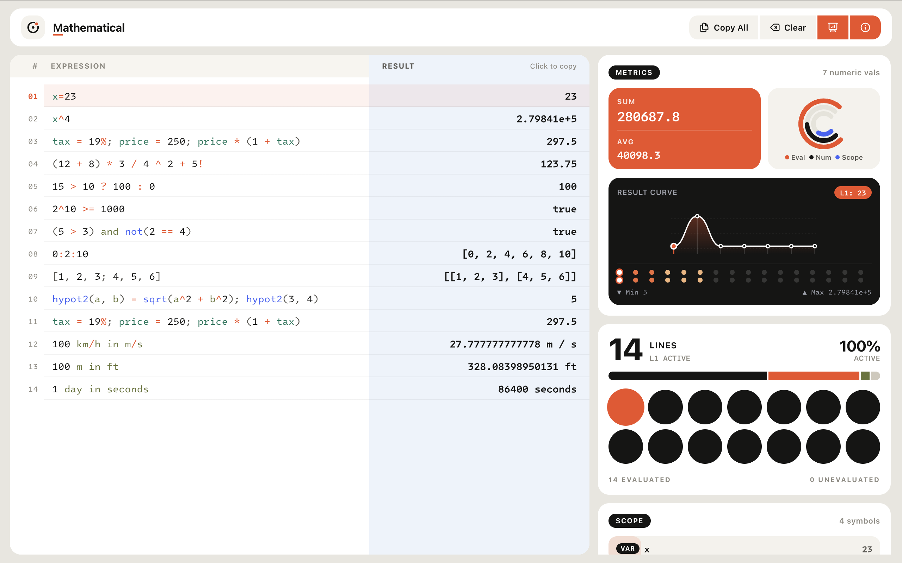

# Mathematical



Mathematical is a minimalist, reactive notepad calculator. It allows users to type mathematical expressions and variables on the left side of the screen and see the evaluated results in real-time on the right side. It combines the freedom of a text editor with the power of a scientific calculator.

## Features

- **Real-time Evaluation:** Calculations are performed instantly as you type, with automatic floating-point precision formatting.
- **Variable & Function Scope:** Define variables (`x = 10`), functions (`f(x) = x^2`), and reference the previous line's result (`ans * 2`), with clickable scope pills in the status bar.
- **Interactive Results & Aggregations:** Click any evaluated result (or the live **Sum** and **Avg** badges in the status bar) to copy it to your clipboard, or copy the entire sheet at once.
- **Synchronized Split-Pane Editor:** Line numbers, active-line highlighting across expressions and results, comment support (`#` and `//`), and automatic light/dark mode based on system preference.
- **Built-in Syntax Guide:** Interactive syntax reference drawer powered by [mathjs](https://mathjs.org/).
- **Persistence:** Your calculations are automatically saved to the browser's `localStorage`.

## Technologies Used

- **React:** UI library.
- **Vite:** Next Generation Frontend Tooling.
- **Math.js:** An extensive math library for JavaScript and Node.js.

## Getting Started

To run this project locally, follow these steps:

### Prerequisites

- Node.js installed on your machine.

### Installation

1.  Clone the repository:
    ```bash
    git clone <repository-url>
    cd calc
    ```

2.  Install dependencies:
    ```bash
    npm install
    ```

### Development

To start the development server:

```bash
npm run dev
```

Open your browser and navigate to the URL shown in the terminal (usually `http://localhost:5173`).

### Building for Production

To create a production build:

```bash
npm run build
```

The output will be generated in the `dist` directory.

## License

See the [LICENSE](LICENSE) file for details.
